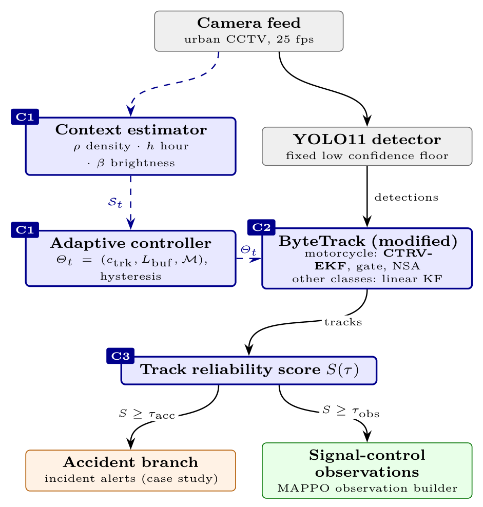
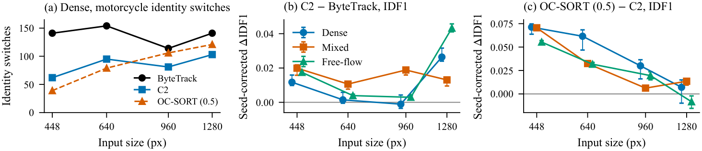
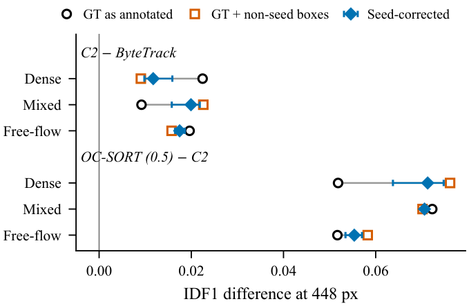
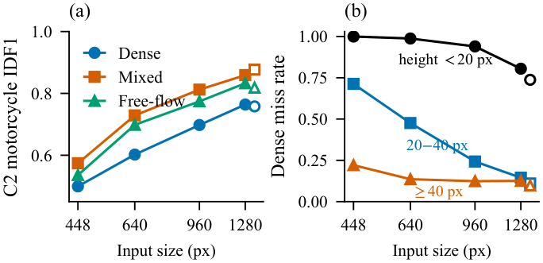

<div align="center">

# Motorcycle Tracking in Dense Mixed Traffic

**A class-conditioned CTRV filter, seed-biased ground truth and the cost of real-time input sizes**

[](LICENSE)
[](https://www.python.org/)
[](https://github.com/ifzhang/ByteTrack)
[](https://github.com/ultralytics/ultralytics)

</div>

Traffic cameras in motorcycle-dominant cities feed incident alerting and adaptive signal control, and both depend on
a detector-plus-tracker front end. Mainstream trackers model every object with one linear motion model, but a
weaving motorcycle turns continuously: during an occlusion the linear filter coasts along a tangent while the
vehicle follows an arc, and the reappearing motorcycle gets a new identity.

This repository contains the code and the committed results of a perception pipeline that adapts along two axes:
per object class, through the motion model, and per traffic regime, through the tracker's operating point. Every
component is reported as measured, including where it does not help.

<p align="center">
  
</p>

## Components

| | Component | What it does |
|---|---|---|
| **C1** | Context estimator and adaptive controller | Reads density, hour and brightness each frame and sets the tracker's confirmation threshold, lost-track buffer and motorcycle motion model, with smoothing and hysteresis |
| **C2** | Class-conditioned motion model | Tracks motorcycles with a constant turn rate and velocity (CTRV) extended Kalman filter inside ByteTrack. Covariance gating re-opens association for lost tracks, and the measurement noise is scaled by detection confidence. Other classes keep the linear filter |
| **C3** | Dual-task track reliability score | One score per track, split by two thresholds into a precision-first alerting branch and a recall-first observation branch |

## Key findings

- **C2 cuts identity switches.** In dense traffic at the 448 px real-time input, motorcycle identity switches
  fall from 141 to 62 (−56%) against ByteTrack on identical detections, almost entirely through the CTRV model.
  The IDF1 gain after correcting for ground-truth seed bias is at most 0.02.
- **A strong baseline still wins.** OC-SORT with matched detection thresholds has the highest IDF1 on all three
  annotated segments at 448 px, and adding C2's motion model to OC-SORT has no clear effect.
- **C1 and C3 do not improve tracking.** C1 switches regimes as intended. C3 filters nothing at its observation
  threshold, and in a one-clip accident case study it keeps the real alert at a two-frame delay.
- **Pre-labelled ground truth is biased toward its seed tracker.** Ground truth corrected from one tracker's
  pre-labels favours that tracker by about 0.04 IDF1, through the boxes it contains rather than their geometry. A
  blind audit found 80% of the other tracker's unmatched runs to be real vehicles; the code brackets and corrects
  the bias.
- **The real-time input size costs small objects.** At 448 px the detector misses virtually all motorcycles under
  20 px tall (99% at 640 px), and a region-of-interest mask that truncates far vehicles adds to the loss.

## Results

Motorcycle tracking on the dense segment (19,213 motorcycle boxes) at 448 px input. All rows consume identical
cached detections. HOTA is reported at α = 0.5, and the values are not corrected for seed bias.

| Configuration | MOTA | IDF1 | HOTA<sub>0.5</sub> | ID switches |
|---|---:|---:|---:|---:|
| ByteTrack (baseline) | 0.294 | 0.477 | 0.397 | 141 |
| ByteTrack + C2 (CTRV, gate, NSA) | 0.313 | 0.499 | 0.412 | 62 |
| ByteTrack + C1 + C2 (+ C3) | 0.313 | 0.496 | 0.412 | 100 |
| OC-SORT, matched threshold 0.5 | **0.352** | **0.551** | **0.453** | 39 |
| OC-SORT, matched threshold 0.6 | 0.295 | 0.489 | 0.396 | **17** |
| BoT-SORT, matched thresholds | 0.301 | 0.491 | 0.412 | 269 |

The mixed and free-flow segments, all four input sizes and the bootstrap intervals are in
[`experiments/paper_final/`](experiments/paper_final/).

<p align="center">
  
  <br><em>Effect of input size. (a) Dense identity switches. (b) Seed-corrected IDF1 gain of C2 over ByteTrack, and
  (c) of OC-SORT over C2, per segment. Bars span the audit share's 95% interval.</em>
</p>

<table>
  <tr>
    <td width="50%"></td>
    <td width="50%"></td>
  </tr>
  <tr>
    <td><em>Seed bias at 448 px: IDF1 differences on the ground truth as annotated, with the non-seed trackers'
    boxes added, and corrected with the audited share.</em></td>
    <td><em>Accuracy cost of the operating point: (a) C2's IDF1 per segment, (b) dense miss rate by object height.
    Hollow markers: reference detector at 1,280 px.</em></td>
  </tr>
</table>

## Repository layout

```
code/
  pipeline.py               end-to-end pipeline (context -> detector -> tracker -> reliability)
  models/                   C1 context estimator and controller, C2 CTRV motion model, C3 reliability score
  tracker/                  adaptive ByteTrack; vendored ByteTrack; OC-SORT and BoT-SORT for comparison
  detection/                YOLO11 detector wrapper
  evaluation/               MOTA, IDF1, ID switches and fragmentation (cross-checked against py-motmetrics)
  scripts/                  experiment runners, seed-bias bracket, operating points, ground-truth review tools
configs/                    ablation configurations: Exp0 baseline to Exp3 (C1 + C2 + C3)
experiments/                committed results and evidence notes (see experiments/README.md)
docs/                       paper scope, experiment protocol, ground-truth annotation and review workflows
notebooks/                  detector training notebook
tests/                      unit tests
```

## Installation

```bash
git clone https://github.com/tronghia256-EdgeAI/moto-ctrv-tracking.git
cd moto-ctrv-tracking
python -m venv .venv
# Windows: .venv\Scripts\activate    Linux/macOS: source .venv/bin/activate
pip install -r requirements.txt -r requirements-dev.txt
```

`ultralytics` installs PyTorch. The tracker, the metrics and the synthetic benchmark run without it, on NumPy, SciPy,
OpenCV and PyYAML.

## Quick start

Run the scripts as modules from the repository root, so that the project package `code` takes precedence over the
standard-library module of the same name.

Synthetic mixed-traffic benchmark, which needs no footage, weights or PyTorch:

```bash
python -m code.scripts.run_experiment --config configs/exp1_C2.yaml --synthetic --save-metrics
```

Your own video, with any YOLO11 detection weights (the COCO checkpoint is used as a fallback):

```bash
python -m code.scripts.run_experiment --config configs/exp1_C2.yaml --video path/to/video.mp4 --save-metrics
```

Ablation configurations:

| Config | Pipeline |
|---|---|
| `configs/baseline.yaml` | Exp0: YOLO11 + unmodified ByteTrack |
| `configs/exp1_C2.yaml` | Exp1: + C2 |
| `configs/exp2_C1C2.yaml` | Exp2: + C1 |
| `configs/exp3_C1C2C3.yaml` | Exp3: + C3 |

## Reproducing the paper's runs

The paper's runs use a fixed protocol: cached detections per input size, a region of interest and the reconciled
ground truth. They need the local footage and annotations, which are not distributed (see below).

```bash
# detect once per input size, replay every tracker on the same cache, then score
python -m code.scripts.run_roi_paper --phase all --sizes 448 640 960 1280 --out data/processed/paper_runs/<run>

# seed-bias bracket for one run and input size
python -m code.scripts.seed_bracket data/processed/paper_runs/<run> 448

# accuracy by input size and object height
python -m code.scripts.operating_points best_448=data/processed/paper_runs/<run>/448
```

The committed outputs of these steps are in `experiments/`, and the paper's figures are drawn from them by
`experiments/paper_final/figures.py`.

## Tests

```bash
python -m pytest
```

The full suite needs PyTorch for the two detector-dependent tests in `tests/test_roi_paper_runner.py`; everything
else runs on the lighter dependencies above.

## Data availability

The evaluation footage consists of third-party traffic-camera recordings and is not redistributed. The
annotations, derived data and detector weights are available from the corresponding author on reasonable request.
No video frames are included in this repository.

## Citation

The accompanying manuscript is in preparation. Until it is published, please cite the software
([`CITATION.cff`](CITATION.cff)):

```bibtex
@software{le2026mototracking,
  author  = {Le, Trong Nghia and Nguyen, Viet Nam and Ho, Minh Hieu and Vo, Xuan Lanh and Nguyen, Thien Bao},
  title   = {moto-ctrv-tracking: Class-Conditioned {CTRV} Tracking for Motorcycle-Dominant Mixed Traffic},
  year    = {2026},
  url     = {https://github.com/tronghia256-EdgeAI/moto-ctrv-tracking}
}
```

## License

The code is released under the [MIT License](LICENSE). The vendored ByteTrack and the bundled OC-SORT and BoT-SORT
code keep their own MIT licenses (`code/tracker/vendor/LICENSE`, `code/tracker/external/*/LICENSE`).

## Acknowledgements

This work builds on [ByteTrack](https://github.com/ifzhang/ByteTrack), [OC-SORT](https://github.com/noahcao/OC_SORT),
[BoT-SORT](https://github.com/NirAharon/BoT-SORT), [Ultralytics YOLO11](https://github.com/ultralytics/ultralytics),
[TrackEval](https://github.com/JonathonLuiten/TrackEval) and
[py-motmetrics](https://github.com/cheind/py-motmetrics).

Contact: Thien Bao Nguyen (baont@ueh.edu.vn), Institute of Intelligent and Interactive Technologies, University of
Economics Ho Chi Minh City (UEH).
